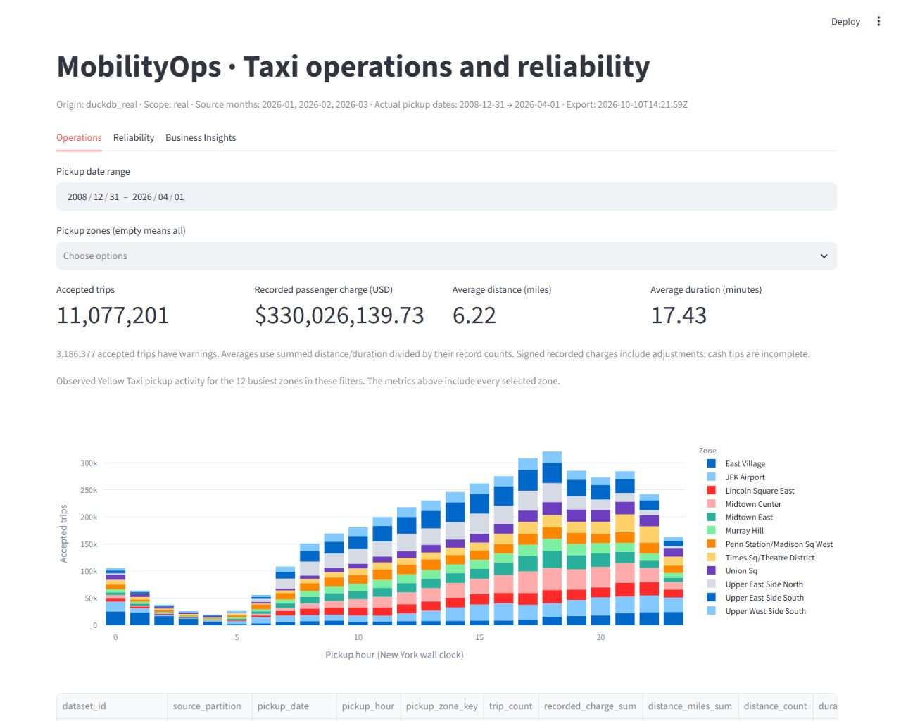
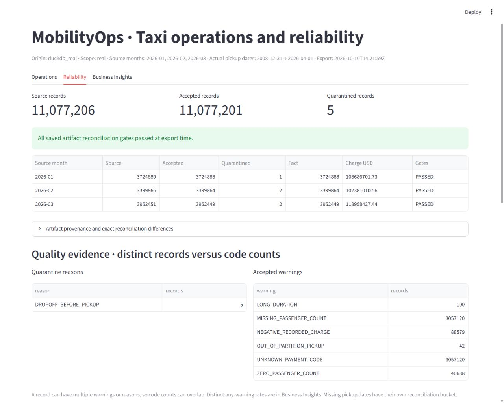
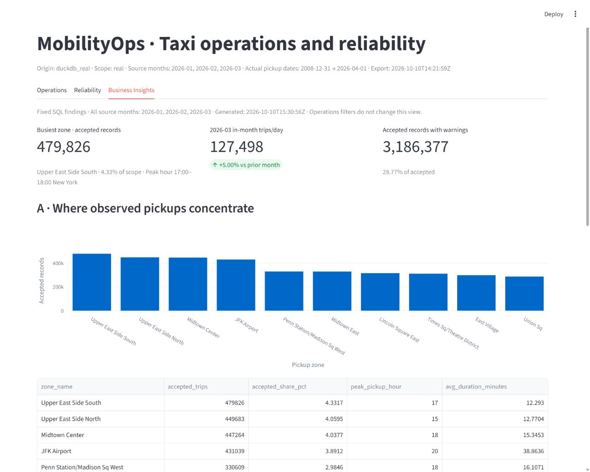

# MobilityOps

MobilityOps turns NYC Yellow Taxi source records into traceable operations metrics and
three measured business findings: where pickups concentrate, how monthly activity changes
after normalizing month length, and where optional-field warnings concentrate.

**Implemented stack:** Python, Requests, PyArrow/Parquet, Decimal, DuckDB, dbt-duckdb,
Streamlit, pandas/Plotly, pytest and Ruff. Official source → immutable manifests → bounded
contracts/profile → one Python classifier → transactional DuckDB → dbt → reconciled SQL
analysis/snapshots → credential-free dashboard. Recruiters can run the committed demo
without the private database, raw monthly files or any warehouse account.

**Verified locally, 10 October 2026:** three consecutive official months, 11,077,206 source
records, 11,077,201 accepted records, 5 quarantined records, and **$330,026,139.73 accepted
recorded passenger charge**. Every artifact's count and monetary differences are zero.
These are historical source records, not globally deduplicated physical trips or profit.
The original completion suite passed **65 offline tests**, Ruff reported **zero diagnostics**, and every
scope's local dbt build passed six models and 24 data tests. Clean isolated installation,
fixture workflow and 11 dashboard checks passed with the existing environments preserved.
The presentation extension's **81 offline tests** passed locally, including 16 SQL/insight
checks; Ruff has zero diagnostics and both app/local-dbt dependency checks pass.

| Scope | Source | Accepted | Quarantined | Accepted recorded charge USD |
| --- | ---: | ---: | ---: | ---: |
| Preserved deterministic fixture | 12 | 8 | 4 | 134.00 |
| Separate January sample | 10,000 | 10,000 | 0 | 293,899.66 |
| January 2026 | 3,724,889 | 3,724,888 | 1 | 108,686,701.73 |
| February 2026 | 3,399,866 | 3,399,864 | 2 | 102,381,010.56 |
| March 2026 | 3,952,451 | 3,952,449 | 2 | 118,958,427.44 |

Source-file months are Jan–Mar 2026. Actual retained pickup dates span **2008-12-31 to
2026-04-01**; the per-day comparison explicitly excludes 42 out-of-partition records, while
headline totals retain them. Charge is signed recorded passenger charge, with incomplete
cash-tip information; it is not profit or complete revenue.

## Three SQL-backed business findings

| Finding | Actual result | Interpretation and limit | Evidence |
| --- | --- | --- | --- |
| Pickup zone/hour activity | Upper East Side South: **479,826 pickups (4.33%)**; busiest hour **17:00–18:00**, 38,469 pickups | Possible positioning/staffing planning input; observed Yellow Taxi pickups do not measure all transport demand or prove an operational benefit | [SQL](sql/analysis/pickup_zone_hour.sql) · [CSV](reports/analysis/real/pickup_zone_hour.csv) |
| Month-length comparison | February: **−8.73%** monthly accepted records but **+1.05%** in-month trips/calendar day; March daily rate **+5.00%** | Normalize month length before comparing activity; weekday mix, seasons and reporting remain limitations | [SQL](sql/analysis/monthly_changes.sql) · [CSV](reports/analysis/real/monthly_changes.csv) |
| Quality concentration | **3,186,377 (28.77%)** accepted records have ≥1 warning; January Astoria: **8,593 / 10,044 = 85.55%** | Investigate optional-field coverage; warnings do not prove incorrect journeys. Zone flags require ≥10,000 records and exceed the month baseline | [month SQL](sql/analysis/quality_month.sql) · [zone SQL](sql/analysis/quality_zones.sql) · [CSV](reports/analysis/real/quality_zones.csv) |

Read [the short findings document](docs/business_findings.md) for exact denominators,
all monthly measures, limitations, SQL concepts and [coverage exclusions](reports/analysis/real/pickup_month_coverage.csv).
[The JSON receipt](reports/analysis/real/business_insights.json) records artifacts, query
hashes, generation time and zero count/charge differences against verified totals.
Multiple warning codes count once in “any warning”; individual code counts can overlap.
Five source records are quarantined (0.00004514%); all have dropoff before pickup.

## Genuine dashboard screenshots

*Operations: actual local Streamlit app, DuckDB real snapshot, all source months/all zones,
full retained pickup-date range. Headline totals include every selected zone; chart shows
the 12 busiest. Capture URL is localhost:8502; original data export is 10 October 2026.*

*Reliability: historical per-artifact gates and warning/reason counts for the same complete
real snapshot. Code counts overlap; this is saved evidence, not a live warehouse monitor.*

*Business Insights: fixed Jan–Mar SQL scope, independent of Operations filters. Origin,
actual coverage, data export and analysis generation time are visible. Screenshots are
unedited browser captures; [capture evidence](reports/evidence/presentation_dashboard.json)
records their checksums and visual review. Earlier captures remain in docs/screenshots.*

## Launch the demo

From PowerShell in the existing workspace:

~~~powershell
Set-Location 'C:\Users\purav\OneDrive\Desktop\Data Projects\MobilityOps'
$env:PYTHONPATH = "$PWD\src"
.\.venv\Scripts\python.exe -m mobilityops.cli validate-snapshot --path demo/published
.\.venv\Scripts\python.exe -m streamlit run app/streamlit_app.py --server.address 127.0.0.1 --server.port 8502 --browser.gatherUsageStats false
~~~

Open localhost:8502; stop with Ctrl+C. Operations shows date/zone filters, pickup activity, signed
charge and weighted distance/duration. Reliability shows dispositions, reconciliation and
actual replay/recovery evidence. Business Insights reads validated exported SQL findings.
The app reads only checksummed small snapshots, has no
warehouse credentials, no cloud fallback and no visitor-triggered pipeline run.

## Reproduce the analysis

Use the existing verified real database; no downloading, classification or model rebuild:

~~~powershell
$env:PYTHONPATH = "$PWD\src"
.\.venv\Scripts\python.exe scripts/run_analysis.py --snapshot demo/published
.\.venv\Scripts\python.exe -m mobilityops.cli validate-snapshot --path demo/published
~~~

Seven readable [analysis SQL files](sql/analysis/) produce seven small CSVs and one JSON
under [reports/analysis/real](reports/analysis/real/). The runner opens DuckDB read-only,
checks the verified artifact set and live counts/charges, and validates formulas/grains.
The optional snapshot attachment copies the three original files byte-for-byte into a
new generation, adds checksummed business_insights.json, validates it, then publishes the
manifest atomically. Rerun analysis after a pipeline snapshot refresh. A new clone can
read committed results and run the demo without reproducing the private real database.

For an offline fixture reproduction after its workflow:

~~~powershell
.\.venv\Scripts\python.exe scripts/run_analysis.py --database data/db/fixture.duckdb --scope fixture --verification reports/local/fixture/fixture/verification.json --output reports/analysis/fixture --snapshot demo/fixture
~~~

## Run the complete local workflow

The wrapper uses .venv for Python and .venv-dbt-local for explicit **--target local** dbt.
Activation/switching is unnecessary. Existing environments and locks are preserved.

~~~powershell
.\scripts\run_local.ps1 -Scope fixture -Offline
.\scripts\run_local.ps1 -Scope sample -Month '2026-01' -Offline
.\scripts\run_local.ps1 -Scope real -Month '2026-01' -Offline
.\scripts\run_local.ps1 -Scope real -Month '2026-02' -Offline
.\scripts\run_local.ps1 -Scope real -Month '2026-03' -Offline
~~~

Drop -Offline only when source preparation/network access is needed. Process real months
sequentially. Fixture/sample/real use separate databases. Replays add no logical source
keys. A changed active source checksum requires deliberate revision review.

Stages are prepare/classify/ingest/models/verify/snapshot; **-Stage models** resumes modeling
after a failure, followed by verify/snapshot. Errors return a failing exit code and append
attempt diagnostics; completed source and snapshot generations survive failed later attempts.

~~~powershell
$env:PYTHONPATH = "$PWD\src"
.\.venv\Scripts\python.exe -m pytest -q
.\.venv\Scripts\python.exe -I -m pip check
.\.venv-dbt-local\Scripts\python.exe -I -m pip check
.\.venv\Scripts\python.exe scripts/verify_local_scenarios.py
~~~

Use **python -m ruff check src tests app scripts airflow/dags** where native Ruff is allowed.
This laptop's Windows Application Control blocks native Ruff/dbt executables; local dbt uses
its installed Python API. The official Ruff 0.16.10 WASM fallback is project-local:

~~~powershell
# Existing .tools install is already present. For a new clone only:
.\.venv\Scripts\python.exe scripts/install_ruff_wasm.py
node scripts/lint_wasm.cjs
~~~

Node is needed only for that fallback, not the pipeline/dashboard. Its integrity receipt
is requirements/ruff-wasm.lock.json. Tests are offline, use mocked downloads and isolated
failure fixtures, and never run a real TLC download or Snowflake action.

## New clone installation

These are reproduction commands, not required reinstallation in this existing folder.
The verified local runtime is Python 3.14.7; minimum source syntax is Python 3.12.

~~~powershell
python -m venv .venv
.\.venv\Scripts\python.exe -m pip install -r requirements.txt
python -m venv .venv-dbt-local
.\.venv-dbt-local\Scripts\python.exe -m pip install -r requirements/dbt-local.lock.txt
.\scripts\run_local.ps1 -Scope fixture -Offline
~~~

Root requirements use the existing exact application lock and editable local package.
Local dbt has its own exact lock. Isolated clean app/dbt installs and a full fixture run
were actually verified without replacing existing environments. For a fresh clone, real
data is intentionally absent; first run a real month without -Offline to prepare it.
Optional activation: **.\.venv\Scripts\Activate.ps1** (then deactivate before switching).

## Deliverables and evidence

| Read | Contents |
| --- | --- |
| [architecture.md](architecture.md) | Implemented architecture, functions, grains, policies, walkthroughs, glossary and interview answers |
| [docs/progress.md](docs/progress.md) | Confirmed checks, current status and resume context |
| [docs/completion_audit.md](docs/completion_audit.md) | Requirement-by-requirement evidence and scope boundaries |
| [docs/operations_runbook.md](docs/operations_runbook.md) | Resume/replay/revision/failure and shutdown commands |
| [docs/data_dictionary.md](docs/data_dictionary.md) | Source/curated/analytical fields and metric interpretation |
| [docs/demo_walkthrough.md](docs/demo_walkthrough.md) | Recruiter demonstration and optional public-hosting instructions |
| [docs/business_findings.md](docs/business_findings.md) | Three findings, interpretation, exclusions and beginner SQL explanations |
| [docs/resume_and_handoff.md](docs/resume_and_handoff.md) | Evidence-backed local wording and conditional cloud wording |
| [docs/snowflake_implementation.md](docs/snowflake_implementation.md) | Complete ordered user-run warehouse steps |
| [reports/evidence/](reports/evidence/) | Actual machine-readable checks and completion audit |

## CI, recruiter demo and publication

The [offline workflow](.github/workflows/offline-checks.yml) uses pinned app/local-dbt locks
in separate Python 3.14 environments. It runs fixture workflow/replay, six local dbt models
and 24 data tests, pytest, lint, dependency checks, small-fixture SQL analysis, snapshot
validation and rollback/backfill scenarios. No Snowflake secrets, full TLC downloads or
private real database are needed. Published real results are static offline artifacts.

**GitHub Actions: verified SUCCESS** for the presentation implementation at
[`f41d2abaef23153bca8a524c26b63ffd8c7d9c12`](https://github.com/PuravDesai004/MobilityOps/commit/f41d2abaef23153bca8a524c26b63ffd8c7d9c12),
[run 38065316682](https://github.com/PuravDesai004/MobilityOps/actions/runs/38065316682).
Every job/step passed, including the new small-fixture SQL-analysis check. The badge tracks
`presentation/sql-business-findings`; [the CI receipt](reports/evidence/presentation_ci.json)
records actual API observations. The earlier main run also passed. Default main remains at
`07b9295`; this update is on a dedicated branch awaiting your review/merge. No force push.

**Three-minute recruiter path:** Operations → Business Insights (explain February's daily
normalization and `LAG`) → Reliability (zero differences and zero-insert replay) → architecture.
Use the [timed walkthrough](docs/demo_walkthrough.md). Avoid running a full month during a demo.

**Public app: not deployed.** Existing [snapshot-hosting instructions](docs/demo_walkthrough.md#public-hosting-preparation--not-deployed)
remain available for your manual deployment. Repository publication and CI do not deploy
Streamlit. No recruiter needs Snowflake credentials or an active warehouse trial.

### Verified resume wording

- Built a replay-safe Python/DuckDB/dbt pipeline across **11.08 million source records**,
  reconciling **11,077,201 accepted / 5 quarantined** records and **$330.03 million signed
  recorded charge** with zero count/cent differences.
- Implemented stable source-row identities, transactional rollback/retry and incremental
  models; an actual 3,724,889-record artifact replay inserted **zero additional records**.
- Delivered reusable SQL for zone/hour activity, month-length comparisons and quality rates,
  plus a credential-free Streamlit demo backed by checksummed, validated aggregate exports.

Docker is unavailable: Airflow DAG/Docker setup is **prepared, runtime pending**; see
[airflow/README.md](airflow/README.md). Snowflake SQL/UDF/profile templates are **prepared,
execution unverified** and only the user may run them. GitHub publication/CI status is
recorded in docs/progress.md; completion.json preserves the earlier local-build audit.
No Snowflake connection, credentials, hosted app deployment or message was performed.
`.env.example` documents explicit local snapshot/interpreter overrides; it is not loaded
automatically. `config/snowflake.example.yaml` is a manual object-name reference only.

Original monthly source, environments, databases and private logs are ignored by Git.
Repository attributes preserve exact file bytes across clones, including checksummed
snapshots, the shared-policy package and original dependency locks.
The preserved 12-row fixture and small demo/published snapshot bundle are repository-ready.
The fixture expectation file's old expected_only flags remain historical documentation;
actual completed classification results are saved separately. Removing this project folder
later removes its local files/environments; globally installed Python remains separate.

## Verified cleanup — 11 October 2026

Removed duplicate clean-install environments, abandoned isolated test state, Python caches,
inactive duplicate fixture/sample/published exports and the obsolete original-build evidence
collector. The published manifest's active generation remains complete. Historical real-month
exports, original source bytes, databases, manifests, reports, screenshots and all three
installed environments/locks are retained. The original clean-install receipts/logs remain
evidence of the earlier installation; their temporary `.checks/clean-*` environments are gone.

The cleanup recheck passed **81 tests**, official Ruff WASM, application/local-dbt dependency
checks, an isolated fixture workflow/replay, **six dbt models / 24 data tests**, fixture SQL,
snapshot validation and isolated rollback/retry/backfill. Fixture reconciliation remains
8 accepted / 4 quarantined / $134.00, with zero count/currency differences and zero replay
inserts. SHA-256 checks confirmed **665 retained files unchanged**. No full real-data rerun
or download was needed. [Cleanup receipt](reports/evidence/cleanup_verification.json) records
the commands, results, backup, deletion inventory and limits. Normal deletion commits retain
earlier Git history. Cleanup uses the existing presentation branch; main awaits review/merge.

