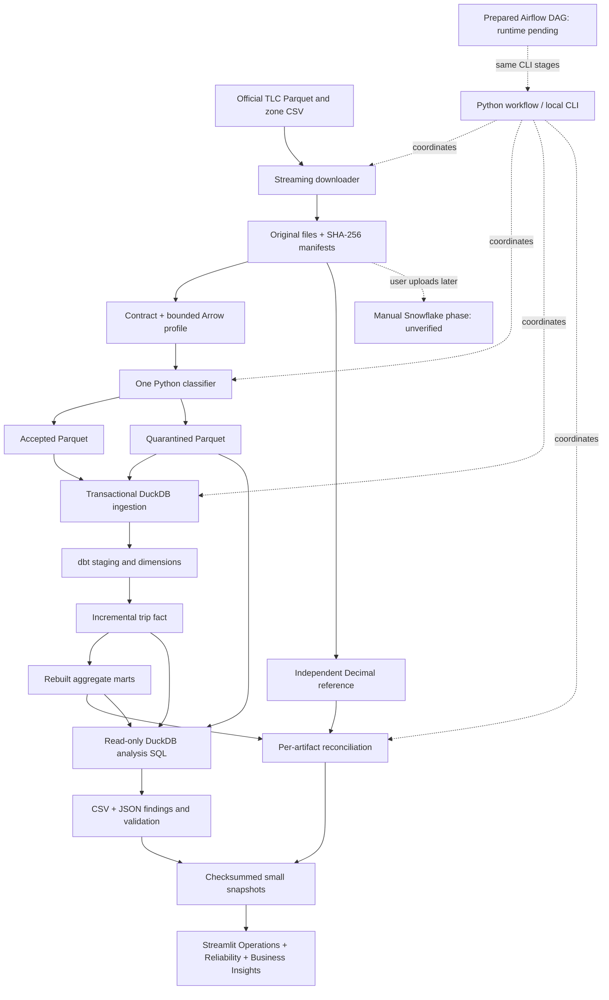

# MobilityOps: implemented architecture and learning guide

## 1. Problem and outcome

A mobility operator needs trustworthy trip counts, recorded passenger charges, and pickup
zone/hour pickup activity. Monthly deliveries can arrive twice, contain malformed values, or fail
halfway through processing. MobilityOps makes the original source, each disposition, and
each reported total traceable. Its working implementation runs on this Windows laptop
without a cloud account. It is a portfolio system with measured correctness, rather than
an operated service with availability guarantees.

The implementation is Python → DuckDB → dbt → validated snapshots → Streamlit. January
through March 2026 have completed verification; see `reports/evidence/completion.json` for
the final coverage and checks, and `docs/progress.md` for current work. Generated Snowflake
objects and the Airflow DAG are separate prepared deliverables. Local transactions do not
demonstrate Snowflake Streams, Tasks, permissions, or billing.



## 2. Technologies and responsibilities

| Technology | What it contributes here | Concrete example |
| --- | --- | --- |
| Python | Downloads, validates, classifies, orchestrates and verifies | A missing pickup creates `MISSING_PICKUP` |
| Requests | HTTP streaming and bounded connection/read timeouts | Write response chunks directly to a temporary file |
| Parquet | Typed, compressed, column-oriented source storage | Read only four required columns for the independent money reference |
| PyArrow | Parquet metadata and batches without whole-month pandas loading | A 10,000-row batch becomes small Python row dictionaries |
| SHA-256 | Content identity and corruption detection | A changed byte changes the artifact checksum |
| YAML/Pydantic | Readable configuration and validated settings | Reject an invalid month or nonpositive batch size |
| Decimal | Exact recorded charge rounding and addition | `1.005` becomes `1.01`, `-1.005` becomes `-1.01` |
| DuckDB | Embedded local analytical database and transactions | Accepted/quarantine inserts and the committed audit publish together |
| dbt | SQL model dependencies, incremental fact, tests and model documentation | `ref('fct_trip')` establishes the mart dependency |
| pandas/Plotly/Streamlit | Read small aggregates, filter, chart and render the demo | A selected date range updates weighted averages |
| pytest/Ruff | Executable correctness checks and static code checks | Inject a failure before commit and assert targets are unchanged |
| Docker/Airflow | Prepared separate orchestration runtime | A manual, paused DAG calls the same stage CLI; runtime pending |
| Snowflake | Future user-run warehouse implementation | Streams and transactional promotion are templates, not verified local features |

The TLC source links were checked against the [official TLC page](https://www.nyc.gov/site/tlc/about/tlc-trip-record-data.page).
The source dictionary describes `total_amount` as a recorded passenger charge with incomplete
cash-tip information. It is not profit or complete business revenue. See the
[Yellow Taxi dictionary](https://www.nyc.gov/assets/tlc/downloads/pdf/data_dictionary_trip_records_yellow.pdf).

## 3. Files and entry points

| Path | Important entry point | Responsibility |
| --- | --- | --- |
| `config/project.yaml` | `load_project_config()` in `config.py` | Paths, month, batch size, retries/timeouts; no credentials |
| `config/contracts/yellow_taxi_v1.yaml` | `validate_required_columns()` | Required versus optional source fields |
| `src/mobilityops/cli.py` | `main()` | One command-line entry point |
| `scripts/run_local.ps1` | PowerShell wrapper | Uses the existing app Python and the separate local dbt Python |
| `.env.example`, `config/snowflake.example.yaml` | Reference examples only | Explicit local overrides and future manual object names; not automatic configuration loading |
| `download.py`, `catalog.py`, `real_source.py` | `download_artifact()`, `prepare_real_source()` | Official URLs, validated downloads, profiles and sample manifests |
| `profile.py`, `sample.py` | `profile_parquet()`, `create_deterministic_sample()` | Metadata/null counts and evenly spaced parent-row selection |
| `identity.py`, `manifest.py` | `sha256_file()`, `trip_record_id()`, `write_manifest_atomically()` | Stable identities, atomic metadata and append-only attempt events |
| `policy.py` | `classify_row()`, `decimal_value()`, `timestamp_value()` | Single pure Python classification policy |
| `classify.py` | `classify_artifact()` | Batches, typed outputs, immutable generations and publication pointer |
| `storage.py` | `ingest_classified()`, `connect_local()` | Stable-key local ingestion and rollback/replay behavior |
| `reference.py`, `reconcile.py` | `eligible_source_charge()`, `reconcile()` | Independent raw-source reference and per-artifact gates |
| `workflow.py` | `run_workflow()`, `run_dbt()` | Ordered stages, failing exit codes, versions, command and timing receipts |
| `dbt/models/`, `dbt/tests/` | SQL models and data tests | Curated sources → dimensions/fact/marts |
| `snapshot.py` | `export_snapshot()`, `load_snapshot()`, `filtered_metrics()` | Candidate validation, checksums, schemas and weighted metrics |
| `sql/analysis/`, `analysis.py` | `execute_queries()`, `run_analysis()`, `validate_analysis()` | Read-only findings; exported formulas, scope/grain/count/charge validation |
| `scripts/run_analysis.py` | `main()` | Run existing verified DB SQL; optionally attach findings to a new snapshot generation |
| `app/streamlit_app.py` | `main()` | Reads snapshots only; does not run a pipeline or contact a warehouse |
| `scripts/verify_local_scenarios.py` | `main()` | Isolated fixture rollback, retry, replay, incremental and backfill evidence |
| `scripts/package_demo.py` | `main()` | Copies a verified small bundle to `demo/published` for review/hosting |
| `airflow/` | `mobilityops_local` DAG | Prepared Docker runtime and sequential local stages |
| `sql/snowflake/` | Ordered SQL and shared-policy ZIP | User-run templates with explicit unverified status |
| `.github/workflows/offline-checks.yml` | Fixture job | Offline pipeline/dbt/tests/lint/SQL/snapshot checks; observed remote status in progress |

Names without a directory in this table are under `src/mobilityops`. `tests/fixtures` and
`tests/expected` are the preserved tiny source and reviewed expectations. Raw monthly
files, classified files, private databases, environments and logs are ignored by Git.
`reports/evidence` and the small published demo are reviewable evidence artifacts.

## 4. Identity, source-row grain and manifests

**Grain** means what one row represents. The original source grain is one physical row in
one unchanged Parquet file. It does not mean one globally unique taxi journey: TLC supplies
no reliable physical-trip key for this design.

```text
artifact_id = sha256(original file bytes)
source_row_number = 1-based physical position in that file
trip_record_id = sha256(UTF-8(artifact_id + ':' + source_row_number))
```

For artifact `abc…` row 2, the identity input is `abc…:2`. Moving the file, changing the run
ID, or trying again cannot change the ID. Two equal payloads at positions 1 and 2 remain two
records. Replaying position 1 adds zero logical records; it is not fuzzy deduplication of
trips from different source files. Database keys include dataset scope. Fixture, sample
and real data use separate DuckDB databases, classification directories, manifests and
snapshots. The real database retains each month's artifact and source partition.

A manifest is a receipt describing an artifact: checksum, bytes, schema, dataset, source
URL/month, rows, contract and zone lookup checksum. Attempt history is a separate JSONL
file, with one JSON event per line. A later failed attempt does not rewrite a prior success.
Writes go to a same-directory temporary file, are flushed, and use atomic replacement.
Readers see either the old completed receipt or the new completed receipt.

The sample selects at most 10,000 evenly spaced physical rows. With 12 parent rows and a
limit of 3, it picks positions 1, 6, 12. Its own Parquet bytes produce a separate artifact
hash. Its local positions 1, 2, 3 generate sample IDs; parent artifact and parent physical
positions remain attached. It is a convenience sample, not a random sample or population
estimate. Combining it with its full source would count overlapping records twice.

If a month already has an active artifact and the source bytes change, preparation,
classification or ingestion stops with a revision-review error. Adopt a revision only in
a deliberate fresh scope after reviewing counts and money. Automatic replacement and
simultaneously active versions are not implemented.

## 5. Streaming, profiling and the contract

The downloader writes network chunks to disk, rather than collecting the whole response
in memory. It uses bounded timeouts and up to three attempts for transient connection,
timeout and retryable HTTP failures. A missing 404 is permanent and stops promptly.
The temporary artifact must be readable Parquet/CSV and satisfy the file contract before
publication. The checksum describes actual bytes, not a URL, filename or HTTP ETag.
An unsuccessful replacement preserves the previous valid file. On rerun the saved manifest,
local checksum and remote validators support verified unchanged reuse.

Some direct requests to the TLC listing return 403 here. `catalog.py` records that failure
and permits only the exact Jan/Feb/Mar/zone links independently reviewed on the official
page on 10 October 2026. It is not a general allowlist of invented months. New links need
fresh official verification.

Parquet profiling records rows, row groups, physical/logical schema, file size and relevant
null counts. Arrow batches cap processing memory. Full raw months never go through pandas;
pandas is reserved for small snapshot aggregates. The four required columns are pickup,
dropoff, distance and total amount. A missing column is a **file failure**, whereas a missing
value in an existing column is a **row reason**. Optional and additional columns survive in
the original file and the curated original-payload JSON.

## 6. Classification, types and disposition

`policy.classify_row()` returns canonical typed values, provenance, original payload and
sorted distinct reasons/warnings. Any blocking reason gives one quarantined record. Multiple
reasons do not make multiple rejected records. Warnings alone retain an accepted record.

| Blocking reasons | Examples |
| --- | --- |
| Missing/invalid pickup or dropoff | Null pickup or a malformed date string |
| Dropoff before pickup | A negative trip duration |
| Missing/invalid/negative distance | NaN, overflow, or even `-0.00001` before rounding |
| Missing/invalid total amount | Null, infinity, text, or decimal overflow |

Warnings cover unresolved zones, missing/zero passengers, negative charge, out-of-month
pickup, unknown payment code, and duration greater than 86,400 seconds. The last is a
project warning threshold, not an official TLC validity rule. Known payment codes are
1–6. Optional values are nullable, rather than guessed or filled with zero.

Money is `DECIMAL(18,2)` and distance `DECIMAL(18,3)`. Conversion uses `Decimal(str(value))`,
not `Decimal(binary_float)`, and `ROUND_HALF_UP`, whose ties go away from zero for either
sign. The **input-range check** requires a finite absolute input smaller than `10^16` for
charge; it does not require the unrounded input to have only 18 decimal digits. The value
is then rounded to two places, and the **stored-value check** requires the rounded result
to fit `DECIMAL(18,2)` (maximum absolute stored value `9999999999999999.99`). Thus
`9999999999999999.994` passes the input-range check and stores as `9999999999999999.99`;
`9999999999999999.995` passes the input-range check but rounds to `10000000000000000.00`,
which fails the stored-value check and produces `INVALID_TOTAL_AMOUNT`. Distance uses the
same two checks at scale 3, with input absolute value smaller than `10^15`.
Negative signed charges remain negative; they are warnings, not discarded revenue.
Distance negativity is checked before rounding, so a tiny negative cannot become valid zero.

Timestamps are naive New York wall-clock values, stored at microsecond precision. Timezone
offset inputs are invalid under this contract. No UTC offset is invented during ambiguous
daylight saving time hours. Duration is elapsed naive wall-clock difference, not a claim of
UTC accuracy across DST. Valid pickup dates outside the file month remain accepted with
a warning and appear in the date dimension and dashboard coverage.

Unrecognized source zone IDs are retained in `*_zone_source_id` and map to dimension key
0 (`Unresolved`). Official member 264 is N/A (borough Unknown), and 265 is Outside of NYC
(borough N/A); both remain valid lookup members. Fixture zones and official real/sample
zones have distinct lookup checksums.

Broken checksum/row identity or parent lineage is a processing failure, not a quarantined
business record. Output publication writes accepted/quarantine Parquet into a new immutable
generation. Only a completed, checksummed `classification.json` pointer exposes it. A failed
candidate is removed from its controlled generation directory; the prior success survives.

## 7. DuckDB publication and model grains

`ingest_classified()` checks checksums, complete row/key coverage, reason dispositions,
zone revision and conflicts. It opens one local transaction for accepted inserts,
quarantine inserts, zones, artifact receipt and successful ingestion audit. Only absent
stable keys are inserted. A failure rolls back all these writes and rethrows. Separate
attempt history records the failure. Table bootstrap is done before the transaction.
DuckDB is configured for two threads and a 1 GB SQL memory limit; this is not a hard limit
on the entire Python process. It may spill to local disk. One workflow writer runs at a time.

| Table/model | Grain and relationships |
| --- | --- |
| `curated.accepted_trips` | One accepted `(dataset_id, trip_record_id)` with original JSON and reason/warning arrays |
| `curated.quarantined_trips` | One rejected key; key set disjoint from accepted |
| `control.source_artifacts` | One active dataset/artifact receipt, source partition, counts and signed charge |
| `control.ingestion_audit` | One committed ingestion attempt, inserted dispositions and replay keys |
| `curated.zones` / `dim_zone` | One lookup zone key, including 0; pickup/dropoff are two references to this dimension |
| `stg_trips` | View of all accepted curated records |
| `dim_date` | One actual accepted pickup date, with calendar year/month/day |
| `fct_trip` | One stable accepted trip key in its isolated scope database; artifact/month retained |
| `mart_zone_hour` | Dataset/artifact/source partition + actual pickup date/hour + pickup zone |
| `mart_daily_reconciliation` | Dataset/artifact/source partition + actual date bucket, including `MISSING_OR_INVALID_PICKUP` |

`dbt` means data build tool. A model is a SQL SELECT that dbt turns into a view or table.
`source()` identifies curated inputs; `ref()` identifies other models and creates dependencies.
A target selects the adapter/profile. Local commands explicitly use `--target local` and
the tracked profile contains no Snowflake target or credentials.

`fct_trip` uses the supported `delete+insert` incremental strategy with a stable unique key
and selects unseen keys. It does not use a maximum event timestamp. February and March
fixtures can load first and an older January fixture can still be added. Real, fixture and
sample scopes never share a fact database. The small marts rebuild from the complete fact,
preserving historical group totals. Partition and artifact keys avoid hiding late or
out-of-partition rows. The missing-date bucket keeps quarantined rows in reconciliation.
See [dbt's incremental model documentation](https://docs.getdbt.com/docs/build/incremental-models).

dbt tests check dimensional and trip uniqueness/non-null fields, zone/date relationships,
disposition disjointness, artifact coverage, domains, mart grain, counts and charge equality.
`dbt docs generate` writes a manifest/catalog locally for model documentation; the workflow
stores these under that run's `reports/local/.../dbt_target`. Adapter-specific array length
uses `len` for DuckDB and `array_size` for Snowflake. The warehouse templates preserve
NUMBER, ARRAY, TIMESTAMP_NTZ and VARIANT types; warehouse compilation/execution remains manual.

## 8. Reconciliation and orchestration

For each active artifact the gates require:

```text
source = accepted + quarantined
all disposition keys are unique and accepted ∩ quarantine is empty
accepted count = fact count = sum(mart trip_count)
accepted charge = fact charge = mart charge = daily charge
independent eligible raw source charge = accepted charge, at zero cent difference
```

The independent reference re-reads only required original fields, using its own eligibility
and Decimal calculation instead of calling the classifier. This can catch a shared data-flow
mistake that comparing only two downstream tables would miss. It is not an independently
audited business rule: it implements the same written contract. Source hashes are checked
before and after this scan. Money/count comparisons are per artifact, so a positive error
in one month cannot cancel a negative error in another.

`workflow.run_workflow()` enforces prepare → classify → ingest → models → verify → snapshot.
Subprocess errors/timeouts produce a failing CLI exit code. Workflow JSON/JSONL records
versions, actual command, elapsed time, stage outcomes and errors. Rerunning starts a new
attempt and reuses verified work. SQL models can be rebuilt after an interrupted model stage;
a successful curated commit is not undone by a later dbt failure. The previously published
dashboard snapshot remains usable until the new complete candidate validates.

The prepared Airflow 3.3.2 DAG runs the same CLI stages, one active run/task at a time,
manual schedule and paused creation. Its XCom values are IDs and paths, not row data.
Prepare uses the downloader's transient retries; permanent contract errors are not repeatedly
retried by Airflow. Other stages allow one retry. Docker is unavailable, so imports/DAG
execution/image/Compose health are pending; Python orchestration is the demonstrated path.
No Snowflake operator or task group is enabled.

## 9. Snapshots and dashboard

The export contains `zone_hour.parquet`, `daily_reconciliation.csv`, `run_summary.json`
and a manifest. An optional fourth file, `business_insights.json`, carries validated SQL
results. Original three-file fixture/sample bundles remain supported. The manifest stores
each file's SHA-256, bytes, relative path, origin,
scope, export time, contract and metric versions. The loader checks path containment,
bytes/checksum, schema/types, nulls, counts, grain, artifact coverage and money equality.
It uses no network, credentials or database. Business analysis additionally checks artifact
identities, complete month/zone coverage, distinct warning denominators, counts/Decimal
charges, exclusions, safe ratios, adjacent-month changes and volume flags. Zone/hour peaks
and weighted durations are cross-checked against the base snapshot aggregate. Missing,
corrupt or inconsistent data gives an explicit error.
Checksums detect alteration; they are not cryptographic signatures proving who exported data.

The app's default bundle is `demo/published`; internal real exports live in `demo/snapshots`.
Fixture/sample bundles have their own directories. Operations filters dates/zones and shows
trip counts, signed charge, observed pickup activity and weighted distance/duration. Reliability shows historical
per-artifact gates, warnings/reasons and actual committed replay plus isolated recovery evidence.
Origin engine, scope, source months, actual pickup coverage, units and export time remain visible.
The UI never invokes a download/pipeline/warehouse and has no cloud fallback.

Average duration = sum(seconds) / sum(duration_count) / 60. With one trip lasting 10 minutes
and nine trips lasting 1 minute, the average is `(10+9)/10=1.9` minutes, not `(10+1)/2=5.5`.
The same additive approach applies to distance after filters. Empty matches show zero *actual
filtered count* and unavailable averages, not invented source data. Snapshot exports and
the repository demo remain accessible after a future trial expires; hosting is optional and
has not been deployed. Local dashboards are sufficient for demonstration.

## 10. Four concrete journeys

**Accepted fixture row 1:** the original artifact hash and position 1 produce a stable key.
Required values parse, the known pickup/dropoff zones map to dimensions, and reasons are empty.
The classifier writes it to accepted Parquet. DuckDB inserts it once, dbt builds its fact and
date/zone references, and its measures enter the date/hour/zone mart. Its original fields
remain inspectable in curated JSON. Fixture row 2 has the same payload but a different key.

**Quarantined fixture row 5:** the pickup column exists but this row's pickup is null.
`MISSING_PICKUP` goes into its reason array. It appears once in quarantine and not in the fact.
Daily reconciliation puts it in `MISSING_OR_INVALID_PICKUP`, so the twelve-row source remains
fully accounted for. Fixing it later requires a reviewed new artifact/policy, not editing
the preserved original source in place.

**Replay:** checksum and output checks allow reuse. Ingestion sees existing accepted and
quarantine keys, inserts zero rows, and commits an audit with replay count twelve for the
fixture. The incremental fact sees no unseen keys. Rebuilt marts preserve totals. An actual
real-source replay is recorded separately in completion evidence; do not confuse it with
the fixture exercise.

**Failure/retry:** in an isolated fixture database the test hook raises after accepted
insertion but before quarantine/receipt/audit commit. Transaction rollback leaves all four
target/audit counts zero. The failure event remains in attempt history. Retry without the
hook inserts 8 accepted/4 quarantined and one successful audit. This is observed DuckDB
behavior; the analogous Snowflake procedure/Stream exercise awaits the user's execution.

## 11. Routine PowerShell commands

Start in the actual project folder. Existing environments need no reinstallation or activation:

```powershell
Set-Location 'C:\Users\purav\OneDrive\Desktop\Data Projects\MobilityOps'
.\scripts\run_local.ps1 -Scope fixture -Offline
.\scripts\run_local.ps1 -Scope sample -Month '2026-01' -Offline
.\scripts\run_local.ps1 -Scope real -Month '2026-01' -Offline
.\scripts\run_local.ps1 -Scope real -Month '2026-02' -Offline
.\scripts\run_local.ps1 -Scope real -Month '2026-03' -Offline
```

Without `-Offline`, a real/sample run verifies official links and downloads/prepares source
if needed. Months are processed sequentially. The sample is deliberately a separate database.
To rerun models after a failure, use `-Stage models`, then `-Stage verify`, then `-Stage snapshot`.
Those stages require prepared sources/classification and fail if the prerequisites are absent.

```powershell
$env:PYTHONPATH = "$PWD\src"
.\.venv\Scripts\python.exe -m pytest -q
node scripts/lint_wasm.cjs
.\.venv\Scripts\python.exe -I -m pip check
.\.venv-dbt-local\Scripts\python.exe -I -m pip check
.\.venv\Scripts\python.exe scripts/verify_local_scenarios.py
.\.venv\Scripts\python.exe -m mobilityops.cli validate-snapshot --path demo/published
.\.venv\Scripts\python.exe -m streamlit run app/streamlit_app.py --server.address 127.0.0.1 --browser.gatherUsageStats false
```

Use `Ctrl+C` to stop Streamlit. To inspect the fixture UI instead:

```powershell
$env:MOBILITYOPS_SNAPSHOT_DIR = "$PWD\demo\fixture"
.\.venv\Scripts\python.exe -m streamlit run app/streamlit_app.py --server.address 127.0.0.1 --browser.gatherUsageStats false
Remove-Item Env:MOBILITYOPS_SNAPSHOT_DIR
```

Activation is optional: `.\.venv\Scripts\Activate.ps1`, or the equivalent path in
`.venv-dbt-local` / `.venv-dbt-snowflake`; use `deactivate` before switching. The Snowflake
environment's installation does not authorize any connection. Use its manual guide only.

## 12. Evidence, limits and tradeoffs

`reports/evidence/completion.json` is the final audit; its supporting workflow, dbt and
per-artifact reports are retained as small evidence. Tests are offline and do not download
full TLC months. The preserved fixture expects 8/4 and $134.00; observed outcomes are separate
from the old expectation file's historical `expected_only` flags.
The requirement-level review is in `docs/completion_audit.md`: 65 offline tests, zero Ruff
diagnostics, six models/24 dbt data tests per scope, five consistent isolated environments,
and 11 additional dashboard checks in the clean application environment all passed.

Current measured source results and version/check gates are in `docs/progress.md`. Timings are
single observed local runs, not throughput benchmarks or savings. Streamlit startup/rendering
and screenshots show actual local behavior, not a deployed public site. The original main
workflow has an observed successful GitHub run; this presentation update uses a dedicated
branch. Exact successful run URLs and commits are recorded in `docs/progress.md` and its
linked evidence; a local test pass is never substituted for a remote run.

Native Ruff/dbt executables are blocked by this Windows Application Control policy. The local
dbt runner uses the installed Python API; lint uses the official Ruff 0.16.10 WASM Node build,
with a verified integrity receipt and the same configured rules. It is an experimental API
fallback, not a bypass or change to the security policy. CI uses normal native Ruff on Linux.
Clean isolated app/dbt environments were used to exercise install/run instructions while
preserving the user's environments. Python 3.12 syntax compatibility is checked; actual
local runtime verification is Python 3.14.7, and the Airflow Python 3.12 image remains pending.

Single-writer transactions and full small-mart rebuilds favor simple correctness at this
scale. No distributed workers, fuzzy trip matching, automatic source revision adoption,
streaming live feed, production service monitoring or cloud automatic retries are claimed.

## 13. Glossary and interview questions

| Term | Meaning here |
| --- | --- |
| Artifact | An unchanged physical file identified by its bytes |
| Manifest | Metadata receipt for that artifact |
| Provenance / lineage | Which file/position/parent produced a record |
| Contract | Required fields and agreed type/quality policies |
| Quarantine | One preserved rejected source record with distinct blocking reasons |
| Idempotency | Rerunning the same source produces no extra logical records |
| Transaction | A group of database writes that all commit or all roll back |
| Incremental | Add only previously unseen accepted keys to the existing fact |
| Dimension / fact / mart | Lookup attributes / trip measurements / small aggregate summaries |
| DAG / XCom | Directed dependency graph / small Airflow task-to-task receipt |
| Snapshot | A fixed reviewed aggregate export for the offline dashboard |

**Why hash bytes rather than filenames?** Names and paths can change; identical bytes preserve
content identity. An altered file gets a different identity and needs revision review.

**Why not deduplicate equal rows?** Equal payloads can be distinct source records. The guarantee
is safe replay of a source row, not global matching of real-world trips.

**Why not load the whole file into pandas?** Batches keep memory bounded while preserving order.
SQL handles stored analytical tables; pandas handles only the small aggregate dashboard.

**Why separate reasons from warnings?** Missing essential measurements block fact creation;
unusual but interpretable trips remain visible instead of being silently dropped.

**Why not use float sums for charge?** Row-level Decimal rounding creates an explicit, testable
cent policy. Signed adjustments and half-cent ties cannot be hidden in binary arithmetic.

**Why is the fact incremental but the marts rebuilt?** Stable-key unseen inserts accept older
arrivals. Full aggregate rebuilds include all historical trips, avoiding partial group totals.

**What does a green reconciliation prove?** The preserved source is accounted for, the key sets
and model counts agree, and the independent written monetary policy matches. It does not prove
the provider's source is a perfect account of every real-world taxi journey.

**What have you demonstrated in Snowflake/Airflow?** Only prepared templates/DAGs and reviewed
syntax so far. Actual local DuckDB, dbt, replay/recovery and snapshot app results are verified.
The user must execute and save warehouse evidence before claiming Snowflake execution.

Your first warehouse step is the private context/privilege/budget inspection in
`docs/snowflake_implementation.md`, not loading a full month immediately.

## 14. Business analysis: existing database to reviewable findings

`scripts/run_analysis.py` → `analysis.run_analysis()` opens the existing DuckDB **read-only**.
It requires passed local verification reports for the exact active artifact set, a single
explicit scope, no unregistered records, and fresh accepted/quarantine/fact count/unique-key
and charge checks. It runs these SQL files within one consistent read transaction:

| SQL file under sql/analysis | Inputs | Output grain / responsibility |
| --- | --- | --- |
| pickup_zone_hour.sql | mart_zone_hour, dim_zone | Pickup zone; volume rank/share, weighted duration, signed charge, peak hour with deterministic earliest-hour tie break |
| monthly_changes.sql | source_artifacts, fct_trip | Source-file month; all accepted count/charge, mean charge, coverage/exclusions, daily rates and adjacent-month LAG changes |
| pickup_month_coverage.sql | fct_trip | Source month × actual pickup month; explains date anomalies without hiding them |
| quality_month.sql | accepted_trips, quarantined_trips, source_artifacts | Source month; distinct any-warning count/rate and quarantine count/rate |
| warning_codes.sql | accepted_trips, source_artifacts | Source month × warning code; distinct records per code, accepted denominator |
| quarantine_codes.sql | quarantined_trips | Source month × blocking reason; distinct records per reason |
| quality_zones.sql | accepted/quarantined trips, dim_zone | Source month × pickup zone; rates, monthly baselines and minimum-volume flags |

**Formulas:** zone share = zone accepted / all accepted × 100. Weighted duration = summed
seconds / summed duration count / 60. Mean charge = signed charge / accepted count.
Any-warning rate = distinct accepted records with ≥1 warning / accepted × 100.
Quarantine rate = distinct quarantined / source × 100. Code counts overlap between codes.
Stable curated keys are checked unique before zone metrics use one-row-per-record sums.

**Month definitions:** source-file totals retain every accepted date, so they reconcile
exactly to prior evidence. Per-calendar-day rate includes only pickups in their own file
month, divided by calendar days. Per-observed-day rate uses distinct observed in-month
dates; observed dates do not establish complete reporting. `LAG` accesses the previous
source month; a comparison is available only for adjacent calendar months. Changes are
current − previous, and percentages are change / `NULLIF(previous,0)` × 100. Missing
comparisons and zero denominators remain null, not fake 0%. The source/pickup-month cross-tab
accounts for every accepted record, including the 42 excluded only from daily normalization.

**Zone screening:** retain all groups, key 0 and official lookup members 264/265. The
elevated-warning flag needs ≥10,000 accepted records and a warning rate above its source-month
rate; elevated quarantine uses ≥10,000 source records and its own baseline. This is a
documented screening choice, not statistical significance or evidence of incorrect trips.

The seven CSV outputs and `business_insights.json` live in `reports/analysis/<scope>`.
The JSON includes exact artifact IDs, query-file hashes, result checksums, definitions,
generation time and passed reconciliation. [Business findings](docs/business_findings.md)
connect each measured result to its SQL/result file, a practical interpretation and a limit.
Counts/charges in every full-source analytical view reconcile to existing verified totals.
SQL runs without pandas loading the monthly source; only small results reach the dashboard.

`snapshot.attach_analysis_snapshot()` copies the existing three data files byte-for-byte to
a new immutable generation, adds the exported analysis, declares its hash/bytes/path and
generation time, validates the whole candidate, then atomically replaces the manifest.
It leaves earlier generations recoverable. The normal pipeline snapshot stage exports the
base three files; **run analysis afterward** to attach findings for the new complete scope.
This explicit step avoids displaying findings from a prior artifact set. A mismatch fails.
`package_demo.py` copies every declared file and validates the candidate, including analysis.

Streamlit's **Business Insights** tab uses only this validated optional file. Its Jan–Mar
scope is fixed and visibly independent of Operations date/zone filters. A snapshot without
analysis shows an honest unavailable message while its original two views still work.
No dashboard path opens DuckDB, downloads data or contacts Snowflake.

```powershell
$env:PYTHONPATH = "$PWD\src"
.\.venv\Scripts\python.exe scripts/run_analysis.py --snapshot demo/published
.\.venv\Scripts\python.exe -m mobilityops.cli validate-snapshot --path demo/published
.\.venv\Scripts\python.exe -m streamlit run app/streamlit_app.py --server.address 127.0.0.1 --server.port 8502 --browser.gatherUsageStats false
```

The real analysis command requires the existing private DB and verification receipts.
For a fresh clone, the committed real CSV/JSON and snapshot suffice for review/app launch.
For reproducible offline SQL execution, run the fixture workflow, then:

```powershell
.\.venv\Scripts\python.exe scripts/run_analysis.py --database data/db/fixture.duckdb --scope fixture --verification reports/local/fixture/fixture/verification.json --output reports/analysis/fixture --snapshot demo/fixture
```

## 15. Presentation and remote checks

The earlier screenshots were inspected first; the Operations image clipped its chart and
the images lacked the new view. New **actual running-app** captures under
`assets/screenshots/` show Operations, Reliability and Business Insights. The old images
remain as historical evidence. The data-export bytes/timestamp are unchanged; the analysis
generation has its own timestamp. Browser automation waits for metrics/charts, captures
unedited JPEGs and visually reviews readable values, axes, labels, loading/error absence
and filter/scope context. `reports/evidence/presentation_dashboard.json` records actual
paths, checksums, dimensions, local URL and observed views. README uses relative image links.

To recapture: launch the exact command above, wait for app/Plotly rendering, select all
dates and no zones, capture Operations with metrics/complete chart, click Reliability for
reconciliation/quality, then Business Insights for fixed SQL findings. Review each image
before replacing a current one; keep scope/filters/origin/dates visible or captioned. The
app's top padding is reduced and its activity chart enlarged for readable desktop review.
Use [the timed three-minute walkthrough](docs/demo_walkthrough.md): app → one SQL explanation
→ reconciliation/replay → honest pending platform boundaries.

CI uses pinned application/local-dbt locks in separate Python 3.14 venvs on Linux. Its
fixture job executes the full tiny workflow twice (including local dbt build/tests/docs),
pytest, native Ruff, dependency checks, fixture SQL/analysis attachment, both fixture and
published-snapshot validation, and isolated rollback/backfill. Tests cover multi-warning
distinct counts, zero denominators, missing/nonadjacent comparisons, weighted means,
out-of-partition filtering, zone buckets/volume flags, scope drift, live-total reconciliation,
updated-checksum semantic corruption, failed attachment preserving the old manifest, and
the actual Business Insights app with database/network calls denied. No real download,
private database or Snowflake secret is required by CI.

The intended existing GitHub remote is preserved. Presentation work is published to a
dedicated branch, with the default branch unchanged and no force push. Remote CI is checked
for its actual commit and conclusion, with receipts linked in `docs/progress.md`. The
earlier completion.json remains a historical pre-publication receipt. Airflow runtime is
still pending without Docker; all Snowflake operations remain manual/unverified. No hosted
app deployment, savings, causation, representative population estimate or SLA is claimed.

**Observed remote result:** presentation implementation commit
`f41d2abaef23153bca8a524c26b63ffd8c7d9c12` passed
[GitHub run 38065316682](https://github.com/PuravDesai004/MobilityOps/actions/runs/38065316682),
including every fixture, lint/test/dependency, SQL/snapshot and recovery step. The actual
job/step API receipt is `reports/evidence/presentation_ci.json`. The README badge points to
this repository/workflow and dedicated branch. Later evidence/documentation commits can
follow the verified implementation commit; each subsequent run has its own actual status.

